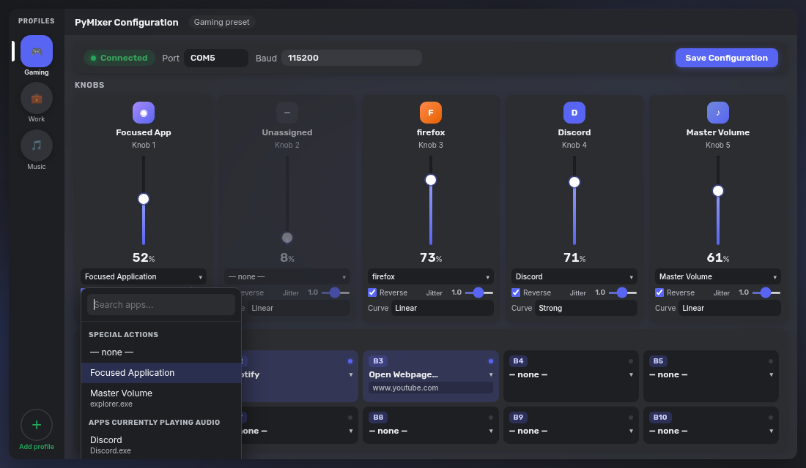
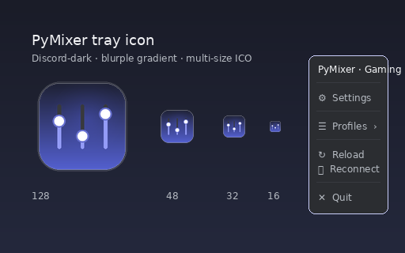
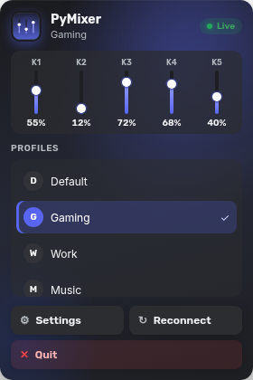

# PyMixer (Discord-dark reskin)

Hardware volume mixer for an ESP32-S3 box + a Windows tray app.

**Original project by [Strafer89](https://github.com/Strafer89)** — this is a fork that adds a Discord-dark settings UI (pywebview), saved **profiles**, live fader readouts, and per-knob response curves. Firmware and the core serial → `pycaw` volume path are unchanged.



## What's new in this fork

- **v1.4.2** — optional **Virtual controller** (Settings toggle, default off): Discord-dark pywebview board with sliders + buttons that drive the same Windows volume / button path as hardware; tray/native menu **Show virtual controller** when enabled; real board pauses virtual (~3s quiet resume); windowless `pythonw` launch
- **v1.4.1** — settings layout fits all 5 knob cards at narrow window widths (minmax grid, short curve labels + hint/tooltip, removed 960px min-width)
- **v1.4.0** — changing a knob curve/reverse re-applies the current board position immediately (bypasses sensitivity once); settings curve labels in plain English with a tiny SVG preview
- **v1.3.9** — durable demo button events (no PermissionError on .tmp); buttons launch any Windows app (.exe/.lnk/protocol/UWP/Start Menu); Start Menu picker + Browse
- **v1.3.8** — pycaw AudioDevice.EndpointVolume compat (Master Volume / mute no longer crash serial thread on Python 3.15 + pycaw 2026); per-knob apply errors isolated
- **v1.3.7** — tray popup profile pills use styled `.pitem` (no white native "DDefault"); case-insensitive pycaw session match; demo is public app + FakeSerial shim only
- **v1.3.6** — settings/tray never invent placeholder live percentages; when the pywebview bridge is missing faders show "—" and retry after `pywebviewready`; live poll always reads the Python API (demo board or pycaw)
- **v1.3.5** — regression suite (board→volume math, status, profiles, save-under-lock, picker contracts, no idle live writes); settings/popup honor an API `demo` flag for status display

- **v1.3.4** — whole button cards (B1–B10) are clickable with hover lift, focus ring, and Enter/Space; empty cards show **Click to assign**, assigned cards reveal **Change ▾** on hover; URL field stays independently editable; knob app triggers are clearer field-style pills with chevrons

- **v1.3.3** — app picker portals to `document.body` (opaque Discord `#1e1f22`, high z-index) so it never clips inside channel/button cards; viewport clamp with 8px margins, flip up/down by available space, max-height + internal list scroll (search pinned), horizontal shift so it never overflows, near-full-width on very small windows

- **Discord-dark settings window** with Rubik + Inter, thin vertical faders, round knobs, blurple Bloom glow, no borders (native Windows frame only — no fake title-bar)
- **Live faders** — display-only meters that read the *current* Windows volume for each knob's mapped target via pycaw (master / app session / focused app); shows "—" when nothing matches. Curve/reverse are already baked into the result the tray applied.
- **Per-knob response curve** — Linear / Gentle / Strong (`volume = x ** exponent`) so the low end gets more travel
- **Jitter filter** (formerly unlabeled "sensitivity") — how far the physical slider must move before volume updates
- **Profiles rail** (add / rename / delete / switch) — Gaming, Work, Music, or whatever you name them
- Tray **Profiles** submenu + hardware button actions `next_profile` and `profile:<Name>`
- **Custom tray popup** (left-click) — frameless Discord-dark panel with profiles, live mini-faders, Settings / Reconnect / Quit; native right-click menu kept as fallback
- Polished multi-size tray **icon** (blurple gradient + mixer glyph)
- **Dark searchable app picker** (knobs & buttons) — groups Special actions / Apps currently playing audio / Other running apps, with friendly names and a "Type an .exe…" escape hatch
- URL field on buttons appears **only** when the action is **Open Webpage…**
- Classic Tk settings UI is still there as a fallback if `pywebview` isn't installed
- `config.py` stays backward compatible; first launch migrates your existing mappings into a **Default** profile (curves default to linear)

## Install (Windows)

```bat
cd PyMixer
python -m pip install -r ..\requirements.txt
pythonw PyMixer.pyw
```

Or double-click `PyMixer.pyw` after the deps are installed.

### Dependencies

See `requirements.txt`: `pyserial`, `pycaw`, `comtypes`, `pystray`, `Pillow`, `pygetwindow`, `psutil`, `pywin32`, `pywebview`.


## Tray popup & menu





- **Left-click** the tray icon → custom frameless popup (pywebview), anchored bottom-right above the taskbar via `SPI_GETWORKAREA`
- **Right-click** → native Windows menu (Settings, Profiles with radio check, Reload, Reconnect, Quit) — also the fallback if pywebview is missing
- Popup **hides** (warm process) on blur / Esc / action — no destroy churn, so Windows shouldn't show a .NET/WebView2 error dialog
- Native **Profiles** submenu (and header / COM status) re-read `config.py` every time the menu opens or after Settings changes (~5 s reload + `update_menu`)
- Native Win32 menus cannot use custom fonts/colors; the popup is where the Discord-dark look lives

## How profiles work

Each profile stores its own knob mappings, button actions, reverse flags, jitter filter, and response curve. Serial port / baud / knob+button counts are shared.

- Switch from the **left rail** in Settings, the tray **Profiles** menu, or a hardware button set to **Next Profile**
- Map a button to `profile:Gaming` (etc.) to jump straight to a named profile
- Button / tray switches update the live tray config immediately (and persist to disk); Settings edits are picked up by the tray on its ~5 s reload
- Edits you make are written into the active profile when you hit **Save** (or when you switch profiles). Saves use a lock + retries so Windows antivirus / another PyMixer window holding `config.py` is less likely to fail with Access Denied.
- Deleting the active profile falls back to another; the last profile can't be deleted

## Knobs: reverse, jitter filter, curve

| Control | What it does |
|---------|----------------|
| **Reverse** | Flips the physical slider direction |
| **Jitter filter** | Deadband — larger values need a bigger physical move before volume changes (filters noisy pots) |
| **Curve** | `linear` (1.0), `gentle` (~1.8), `strong` (~3.0). Strong keeps more of the travel in the quiet range |

Live fader % in Settings is the post-reverse, post-curve volume the tray would apply.

## Editing the look

The settings chrome is plain HTML/CSS/JS under `PyMixer/ui/`:

| File | What it does |
|------|----------------|
| `ui/index.html` | Layout |
| `ui/style.css` | Colors, faders, rail — tweak this for a reskin |
| `ui/app.js` | Wiring to the Python bridge |
| `ui/fonts/` | Bundled Rubik + Inter (SIL OFL) |

No need to touch `PyMixer.pyw` or the ESP32 sketch to change colors.

## Hardware

See `ESP32/Volume_Mixer.ino`. The box streams `knob|knob|…|button|button|…` over serial at 115200 baud. Default mapping expects **5 knobs + 10 buttons**.

## License

GPL-3.0 (same as upstream). Fonts under `PyMixer/ui/fonts/` are SIL OFL — see `OFL.txt` there.

## Credits

- **Strafer89** — original PyMixer hardware + Windows app ([github.com/Strafer89/PyMixer](https://github.com/Strafer89/PyMixer))
- Reskin + profiles — TechTheNoob fork
